# One fragment

::: {.absolute top="0" left="96%"}
::: sectionhead
1 [2 3 4 5 6 7 8]{style="opacity:0.25"}
:::
:::

---

## KBo 41.22: a fragment filed under CTH 470

::: {.columns}
::: {.column width="52%"}

:::
::: {.column width="48%"}
- Seventeen broken lines of a reverse column, **33 legible words**
- {MUNUS}ŠU.GI, the "Old Woman", speaks (l. 10′); a {LÚ}A.ZU, "physician", acts (l. 12′)
- *DINGIR.MEŠ-aš karpin pangawaš EME-an* (ll. 4′, 11′): "the anger of the gods, the tongue of the multitude"
- A purification ritual, but **no parallel passage** has been found, so Laroche's system can only file it as CTH 470, "fragments of rituals"
:::
:::

::: {.notes}
Start here: one small fragment, the kind TLHdig holds by the thousand.
Text from TLHdig 0.3 (run_case.py, case_KBo_41_22.json).
:::

---

## What would a philologist say?

::: {.columns}
::: {.column width="50%"}
**The clues point in more than one direction**

- The Old Woman and the physician are the practitioners of the **Kizzuwatna rituals** (Miller 2004), the largest ritual tradition
- "The tongue of the multitude" belongs to the Luwian purification rituals of the Lower Land: the **Great Ritual of Kuwattalla** (CTH 760; Mouton and Yakubovich 2019) and the rituals of **Tunnawiya** (CTH 409)
- Tunnawiya and Kuwattalla were compared already by Laroche (1955); Mouton places both in the Lower Land, Kuwattalla as the more "Hurrianized"; Miller (2004: 255–58) keeps CTH 409 apart from the Kizzuwatna rituals
:::
::: {.column width="50%"}
**What the method can add**

- Which tradition the *whole* fragment resembles, and by how much
- **Which words** carry that decision
- **Which manuscripts** are closest, as places to look for a parallel or a join
- Whether the answer is **strong enough to state**, or the fragment should stay unplaced
:::
:::

::: {.notes}
The scholarly literature gives candidates, not an answer: three traditions are plausible for this fragment.
References: Laroche 1955 (RHA 13/57); Miller 2004 (StBoT 46): 255–58; Mouton 2015; Mouton and Yakubovich 2019 (BSOAS 82/2); Goetze and Sturtevant 1938; Hutter 1988. Check page references before the talk.
We return to KBo 41.22 in section 6.
:::

# Laroche's bins

::: {.absolute top="0" left="96%"}
::: sectionhead
[1]{style="opacity:0.25"} 2 [3 4 5 6 7 8]{style="opacity:0.25"}
:::
:::

---

## Where unplaced fragments end up

::: {.columns}
::: {.column width="52%"}
::: {.small}

| Laroche's bin (TLHdig 0.3) | texts | median legible words |
|---|---:|---:|
| CTH 470, fragments of rituals | 1,919 | 10 |
| CTH 500, fragments of Kizzuwatna rituals | 479 | 17 |
| CTH 670, fragments of festivals | 3,506 | 10 |
| CTH 832, fragments of various content | 4,080 | 4 |
| CTH 390–469, rituals no study groups | 571 | 19 |
| EBo fragments (all CTHs) | 1,151 | 4 |

:::
:::
::: {.column width="48%"}
- The CTH is a **catalogue of compositions**. When the composition is unknown, a fragment goes to a **genre bin**
- The bins are filing decisions, not traditions: CTH 500 is a running list; CTH 390–469 holds named rituals that no study has grouped
- Traditional assignment needs a **parallel passage**, which is exactly what these fragments lack
- **The question:** can the *content and spelling* of a fragment point to its tradition, and when should we say we do not know?
:::
:::

::: {.notes}
Numbers from stats_corpus.py (corpus_stats.json, laroche_bins).
The EBo fragments, digitised in TLHdig 0.3 (May 2026), are filed mostly under CTH 832 and 670, which are themselves bins.
The median of 4 words for CTH 832 and EBo is the hard constraint for everything that follows.
:::

---

## How this approach treats the bins

1. **Build a reference** from traditions that published studies define, not from CTH ranges
2. **Place each fragment** with the tradition it resembles most, **or abstain** when the lead over the runner-up is small
3. **Show the evidence**: every placement splits into the words and sign sequences that carry it
4. **Test the bins themselves**: CTH 500 and the CTH 390–469 residue are placed like orphans, not used as reference
5. **Hand the result back** to philology: a placement is a hypothesis, with the nearest manuscripts as candidate parallels and joins

# The traditions

::: {.absolute top="0" left="96%"}
::: sectionhead
[1 2]{style="opacity:0.25"} 3 [4 5 6 7 8]{style="opacity:0.25"}
:::
:::

---

## What we mean by a tradition

::: {.columns}
::: {.column width="55%"}
- A **tradition** is a group of compositions that a published study ties together by an **external criterion**:
  - a place of origin ("from Kizzuwatna", "from Arzawa")
  - a named practitioner (Puriyanni, Kuwattalla)
  - a cult centre or deity (Ištanuwa, Ḫuwaššanna)
  - a language layer (Hattian, Palaic)
- The criterion is **not** the vocabulary we measure, so the test is not circular
- **Laroche's CTH numbers are the addresses**: each tradition is a list of CTH numbers taken from its defining study
:::
::: {.column width="45%"}
**An archetype** is the tradition's profile in the data: the mean of its manuscripts' word and sign frequencies.

**An orphan** is a fragment that no edition has placed in a composition (CTH 470 and the EBo fragments). Orphans are **never** part of the reference.
:::
:::

---

## The ten traditions

::: {.small}

| Tradition | CTH | Defined by | Criterion | Texts |
|---|---|---|---|---:|
| Kizzuwatna–Lower Land (Hurrian) | 628, 699, 700, 711–713, 719, 722 | StBoT 73; ChS I/4 | cult geography | 318 |
| Syro-Mesopotamia (Hurrian) | 698, 701, 714, 715, 721 | StBoT 73; ChS I/2 | cult geography; AZU priest | 167 |
| Mixed (Hurrian, Syrian, Luwian) | 704–706, 720 | StBoT 73 | mixed pantheon | 200 |
| Luwian festivals (Ištanuwa, Lallupiya) | 665, 771–773 | HFR module | cult centres | 52 |
| Ḫuwaššanna festivals | 690–694 | HFR module; Laroche | the goddess in every title | 189 |
| Palaic festivals | 750–754 | HFR module | Palaic language | 34 |
| Kizzuwatna rituals | 471–499, 404 | Miller 2004; Strauß 2006 | practitioners "from Kizzuwatna" | 165 |
| Western (Arzawa) rituals | 394, 402, 406, 410, 425, 433 | colophons; Bawanypeck 2005; Archi 2015 | "from Arzawa / Ḫapalla"; augurs | 11 |
| Luwian rituals (Puriyanni, Kuwattalla) | 758–763 | Yakubovich and Mouton 2023 | named practitioners; Lower Land | 10 |
| Hattian cult layer | 591, 627, 725–746, 820, 821 | Klinger 1996 | Hattian deities and language | 480 |

:::

[Placed like orphans instead: CTH 500, the Ambazzi rituals (391, 429, 463; Luwian influence but no stated link to Arzawa, Christiansen 2006), Tunnawiya (409) and the rest of CTH 390–469. Texts = manuscripts of 17+ words, 1,626 in all.]{.small}

# From StBoT 73 to placement

::: {.absolute top="0" left="96%"}
::: sectionhead
[1 2 3]{style="opacity:0.25"} 4 [5 6 7 8]{style="opacity:0.25"}
:::
:::

---

## Where we left off: StBoT 73

::: {.columns}
::: {.column width="50%"}
- Gordin, Yavasan and Romach 2025: tf-idf + t-SNE over ~1,000 Hurrian and Luwian festival texts
- Three "constellations"; Luwian cult centres coherent, the Hurrian groups split
- CTH 701 under the microscope: KBo 23.44 (a.B, Nananza under Anuwanza) vs KBo 38.281+ (a₁.3, MS)
- **Next step announced there:** test which word groups carry the signal
:::
::: {.column width="50%"}
::: {.small}

| | StBoT 73 | This study |
|---|---|---|
| Question | do festival texts cluster? | where does a fragment belong? |
| Texts | ~1,000 festival texts | 23,526 manuscripts, rituals included |
| Groups | CTH clusters, read from a map | ten traditions from the literature |
| Output | a map | a placement, or an abstention |
| Evidence | top terms per cluster | the words behind each decision |
| Word groups | announced | tested (word classes, layers) |

:::
:::
:::

# Method

::: {.absolute top="0" left="96%"}
::: sectionhead
[1 2 3 4]{style="opacity:0.25"} 5 [6 7 8]{style="opacity:0.25"}
:::
:::

---

## The pipeline

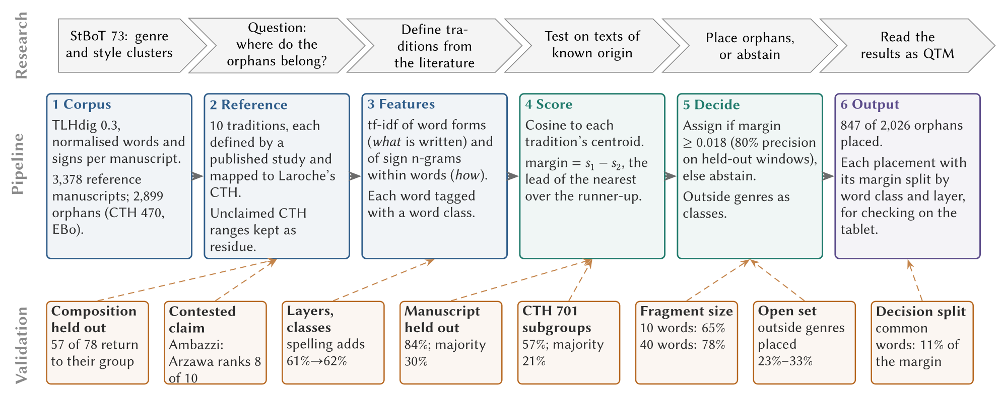{fig-align="center" width="100%"}

::: {.notes}
Corpus: TLHdig 0.3 XML, 23,526 manuscripts, 1.24 M words, converted following Yavasan and Gordin, From Clay to Code (ALP 2025).
Two feature spaces: word tf-idf (what is written) and sign n-grams of 1–3 signs within a word (how it is written).
Each tradition is the centroid of its manuscripts; a fragment goes to its nearest centroid only if its lead over the runner-up passes the margin (0.018).
Figure from the paper (paper/figures/pipeline.tex), built from the same results files.
:::

---

## How a word gets its category

[The part of speech comes from **rules over TLHdig's own morphological analyses**, made by its editors (`qtm/wordclass.py`); the categories follow StBoT 73, Table 4. Nouns are then sorted by the **meaning of TLHdig's German gloss**: realia (things, ritual materials, plants), places, animals and body, abstract nouns, adjectives. That gloss list (5,494 glosses) was drafted by Claude and is a fixed, correctable file (`labels/gloss_lexicon.tsv`).]{.smallish}

::: {.smallest}

| Written | TLHdig's analysis (editor's choice) | Rule | Category | Confidence |
|---|---|---|---|---|
| nu | *nu* · CONNn (connective) | tag of the selected analysis | Function word | high |
| na-at | *n=at* · CONNn=PPRO.3SG.N.NOM or .ACC "and it" (no choice made) | readings agree; head CONNn | Function word | medium |
| A-NA {GIŠ}BANŠUR | one TLHdig word: BANŠUR "table", …:D/L.SG | split: preposition + noun | A-NA function word; BANŠUR noun | high |
| da-a-i | *dā-* "take" · 3SG.PRS · stem class II.2 | verbal stem class | Verb | high |
| BE-LÍ-IA | BĒLU "lord" · NOM.SG_PPRO.1SG.GEN | head (NOM.SG); the suffix "my" does not count; gloss "Herr": a person | Agent | medium |
| {MUNUS}ŠU.GI | determinative MUNUS "woman" | determinative | Agent | high |
| {m}Kupanta-{D}KAL | determinative m (a man's name) | person before deity | Agent | high |
| {D}UTU-uš | determinative D | determinative | Deity | high |
| ar-ḫa (no choice made) | candidates: "stand" 1SG, ADV, POSP, PREV, "border" | the editors' choice for *arḫa* elsewhere (1,835 of 1,836) | Function word | medium |
| *šiena* (Hurrian line) | the line's language: Hurrian | language tag | Foreign word | high |
| ~zi (broken word) | none | — | unknown | low |

:::

::: {.notes}
Examples with their raw TLHdig attributes: results/wordclass_examples.csv (review_wordclass.py examples).
The rule order: the word's own language tag, then determinatives (m before D, so theophoric personal names are people), then the analysis the editor selected, then the analyses if they all agree on the head word class, then the class editors selected for the same form elsewhere (at least 5 times, 90% agreement).
:::

---

## How sure are the categories?

::: {.columns}
::: {.column width="50%"}
::: {.small}

| Confidence | basis | share of words |
|---|---|---:|
| high | editor's selected analysis, determinative, language tag, split or Akkadian preposition | 62.7% |
| medium | all analyses agree; same form selected elsewhere; agent logogram | 25.1% |
| low | analyses disagree, or none (broken words) | 12.2% |

:::

[320,638 legible words in the texts the experiments use (`wordclass_confidence.json`).]{.small}
:::
::: {.column width="50%"}
::: {.smallish}
- **A philologist's blind audit** of 178 words (about 60 per level): **93% right** at high confidence, **88%** at medium, **70%** at low; **89%** of all words, weighted by level
- Five rules revised on the audit's notes (broken enclitic chains, determinatives of unanalysed words, compound logograms ...); 2.2% of the words changed. In-sample, the audit now scores 97 / 88 / 88%, **94%** overall (an upper bound), and **every experiment was rerun**
- **Correcting by hand:** a review sheet of the most frequent forms and a corrections file that every run applies (`review_wordclass.py`)
- **Known limits:** 9.3% unknown, most of them broken words; syllabic Akkadian *ša* has no analysis; participles count as verbs; the noun meaning classes have not been audited
:::
:::
:::

::: {.notes}
The class results (word classes and decision shares) should be read with this confidence in mind; removing a whole class changes accuracy by at most 7 points (E8), so a few per cent of misclassified words cannot drive them.
Audit: labels/wordclass_audit.csv (the philologist's marks and notes), results/wordclass_audit_scores.json (before and after the rule revisions, review_wordclass.py score / rescore).
Rule changes: results/wordclass_rule_changes.csv (first audit), results/wordclass_rule_changes_audit.csv (philologist's audit and the meaning classes: 19% of the words moved, 2.2% by the revised rules).
The noun meaning classes replace the single 'realia' class of StBoT 73 at the philologist's request: realia proper is the cultural layer and should not be mixed with abstract nouns and adjectives.
:::

# Results

::: {.absolute top="0" left="96%"}
::: sectionhead
[1 2 3 4 5]{style="opacity:0.25"} 6 [7 8]{style="opacity:0.25"}
:::
:::

---

## Do the traditions hold? Leave one manuscript out

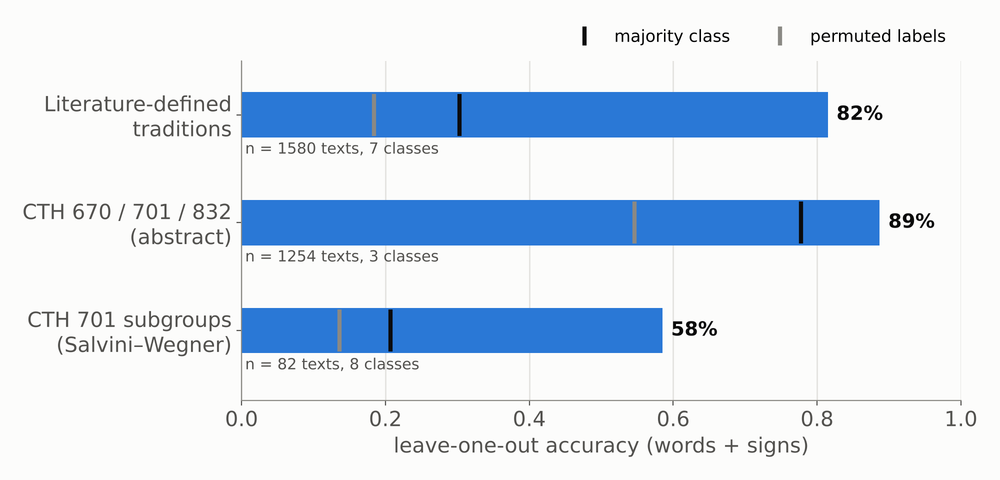{fig-align="center" width="80%"}

::: {.small}
Every manuscript of 17+ words is removed in turn and placed against the traditions built from the rest. Baselines: always guessing the largest tradition, and the same procedure with shuffled labels (200 permutations).
:::

::: {.notes}
84% over 10 traditions against a 30% majority baseline (p = 0.005). With Laroche's CTH ranges as classes, 72% against 23%.
By tradition: Hattian 95%, Ḫuwaššanna 93%, Kizzuwatna rituals 92%, Ištanuwa/Lallupiya 83%, Palaic 82%, Kizzuwatna–Lower Land 82%, Syro-Mesopotamia 68%, Mixed 68%, Arzawa 64% (11 manuscripts), Puriyanni/Kuwattalla 40% (10).
:::

---

## Leave one composition out: are the scholarly groups recovered?

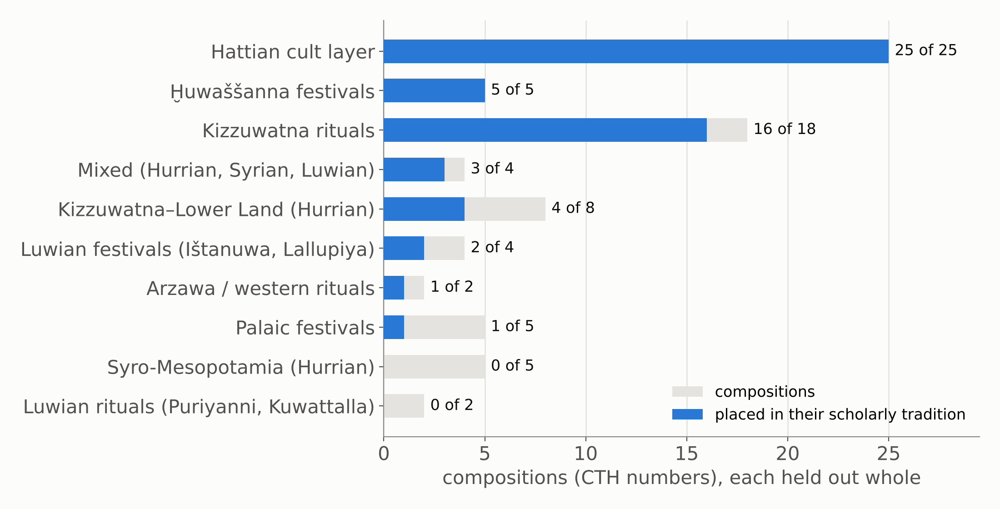{fig-align="center" width="78%"}

::: {.small}
Each CTH number is removed with all its manuscripts and placed against the traditions built from the rest, so no copy or duplicate of the same composition can help.
:::

::: {.notes}
57 of 78 compositions (73%) land in their scholarly tradition.
Confirmed where a tradition has many compositions: Hattian layer 25 of 25, Ḫuwaššanna 5 of 5, Kizzuwatna rituals 16 of 18.
StBoT 73's three Hurrian festival groups hold only 7 of 17: CTH 701 goes to the Kizzuwatna rituals, 698 to Kizzuwatna–Lower Land.
Palaic festivals: 3 of 5 go to the Hattian layer.
The two small ritual groups rest on one large composition each (433 augurs, 760 Kuwattalla); held out, both go to the Kizzuwatna rituals.
:::

---

## A contested attribution: the Ambazzi rituals

::: {.columns}
::: {.column width="55%"}
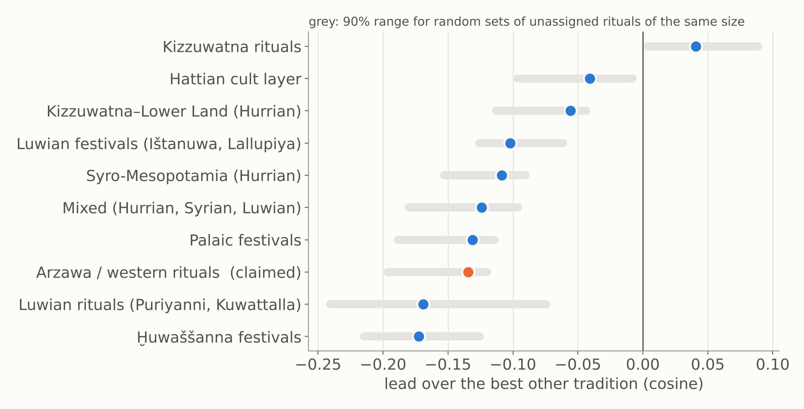{width="100%"}
:::
::: {.column width="45%"}
::: {.smallish}
- The six Ambazzi manuscripts (CTH 391, 429, 463), pooled, rank the **western (Arzawa) group 8th of 10**; their lead is what random unassigned rituals get (p = 0.18)
- **None of the 20 most distinctive western words** occurs in them except É: no *kurša-* "hunting bag", KAL, MUŠEN.DÙ "augur", TU₇, *paimi*, *pattar*
- Their own words (*ḫaršialli*, *aki*, *petaz*) occur in at most 3% of any tradition's manuscripts
- Nearest is Kizzuwatna (5 of 6), but no more than for any unassigned ritual (p = 0.66): **a generic ritual, not a member of a defined tradition**
:::
:::
:::

::: {.notes}
The method tested against a scholarly attribution. Christiansen 2006 shows Luwian influence; grouping Ambazzi with the western rituals was our own first literature grouping, and the method does not support it.
Caveat: the western group is small and dominated by the augur rituals (CTH 433).
Files: E10b_contested_fit.csv, E10c_signatures_in_contested.csv, E10c_contested_own_words.csv.
:::

---

## How small can a fragment be?

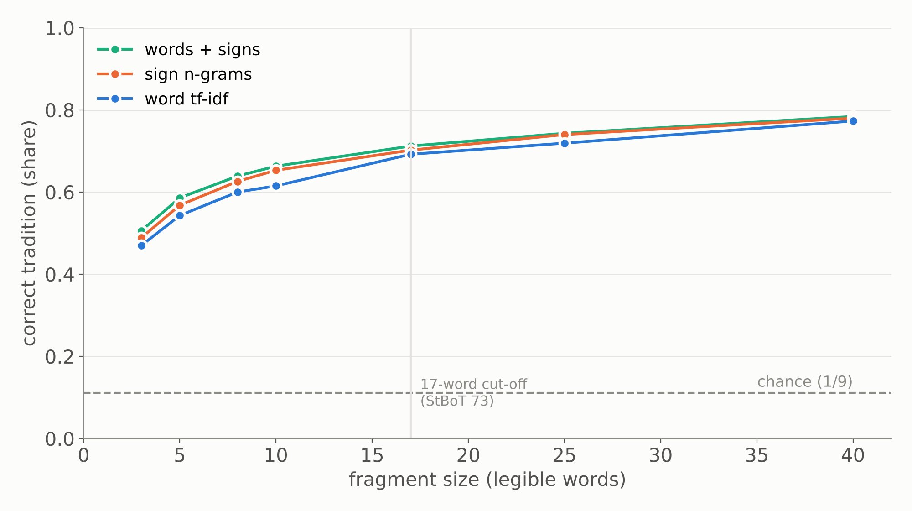{fig-align="center" width="75%"}

::: {.small}
Long manuscripts are cut into random windows of *k* words and placed. The abstention margin (0.018) is set where placed windows are right 80% of the time.
:::

::: {.notes}
3 words: 50%; 10 words: 65%; 40 words: 78%, against a chance level of 10%.
Above the margin, 80% of placed windows are right and 66% of windows are placed.
:::

---

## Is it vocabulary, orthography, or date?

::: {.columns}
::: {.column width="50%"}
**Remove all logograms** (Sumero- and Akkadograms)

- word tf-idf: 82% → 76%
- sign n-grams: 84% → 81%

The signal survives without the cultic logographic vocabulary.
:::
::: {.column width="50%"}
**Script date** (MS vs NS)

- inside CTH 701 the method does *not* predict script date above the majority baseline (73% vs 83%)
- neither do the orthographic rates (79% vs 83%)

So the groupings are not script-date clusters.
:::
:::

---

## What identifies a tradition: what is written, or how?

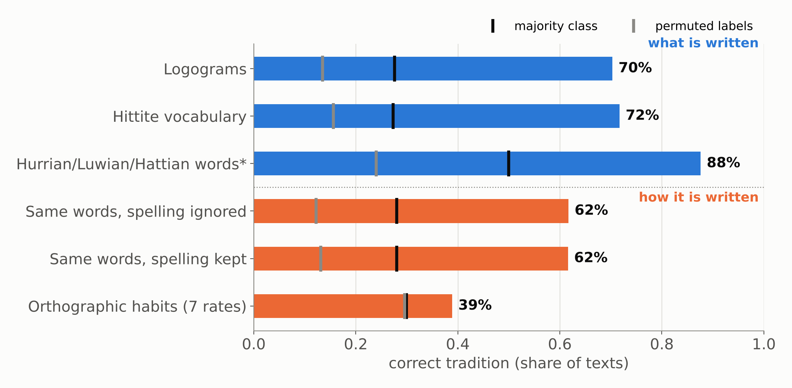{fig-align="center" width="78%"}

::: {.small}
Each layer alone, leave one manuscript out, 10 traditions, 1,627 manuscripts. *Only the 396 manuscripts with foreign-language words. Orthographic habits: 10-fold LDA on seven per-text rates.
:::

::: {.notes}
Content carries the identity: logograms 69%, Hittite vocabulary 73%, foreign-language words 88% where present.
Keeping the spelling of variable words adds next to nothing (62% vs 61% with spelling ignored).
Text-level orthographic habits are a weak but real signal: 40% against 29% for shuffled labels.
:::

---

## Cultural profiles: each tradition's distinctive vocabulary

::: {.small}

| Tradition | Logograms | Hittite and foreign words |
|---|---|---|
| Kizzuwatna rituals | SÍG, ZA.GÌN, SA₅, LÀL, ŠU.GI | *tarpalli-*, *ḫuittiya-*, *kureššar*, *lukkatta* |
| Kizzuwatna–Lower Land | *UP-NI*, BA.BA.ZA, *NAM-MA-AN-DUM* | *manuzzi*, *nupatik*, *šipant-*, *keldi* |
| Syro-Mesopotamia | AZU, EREN, SÍSKUR, AD.KID | *ḫurlili*, *ḫuprušḫi*, *aḫrušḫi*, *kelu* |
| Mixed | KI.MIN, NINDA.SIG, IŠTAR | Ḫepat, Ninatta, Kulitta |
| Ištanuwa and Lallupiya | ZA.LAM.GAR, KA.GAG, DUMU.LUGAL | *ḫuḫupal*, *kimri*, *ḫuwaši* |
| Ḫuwaššanna | *BE-EL*, NAR, SÌR-RU, KAŠ | *palwai-*, *aku-* "drink", *takarmun* |
| Palaic festivals | GEŠTIN, ŠU.GI, *AŠ-RI* | *išnuri*, *ziparwa*, *kataḫzipuri*, *ḫašammili* |
| Hattian cult layer | LUGAL, DUMU.É.GAL, GIŠ.INANNA, ALAM.ZU₉, MUḪALDIM | *ḫalzai*, *petai*, *taparna*, *katte* |
| Western (Arzawa), 11 texts | KAL, MUŠEN.DÙ, TU₇ | *kurša-*, *pattar*, *lak-* |
| Puriyanni and Kuwattalla, 10 texts | EME, SAG.DU, ŠU.GI | *pankawaš*, *karpi-*, *linkiya-* |

:::

[Weighted log-odds with an informative prior (Monroe et al. 2008), counted by manuscripts. Full lists in `E7_distinctive_features.csv`.]{.small}

::: {.notes}
Ritual materials, offerings, performers and deities: the cultural and religious "artefacts" of each tradition.
Note the last row: EME, *pankawaš*, *karpi-* are exactly the words of KBo 41.22.
:::

---

## Scribal profiles: habits of copying lines, not regions

::: {.columns}
::: {.column width="58%"}
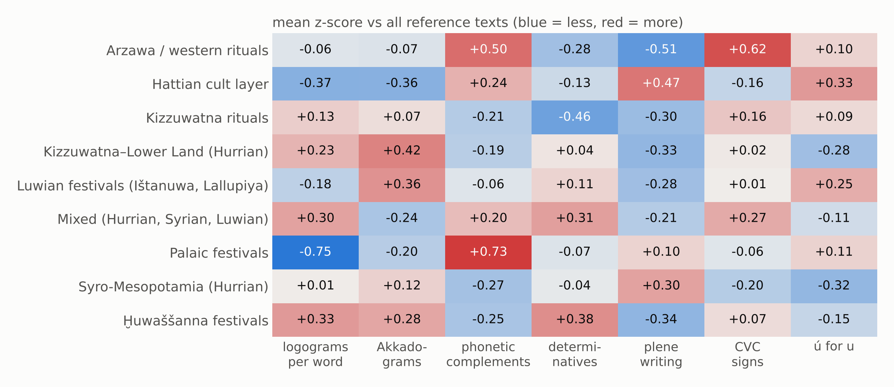{width="100%"}
:::
::: {.column width="42%"}
::: {.small}

| Same word, plene spelling | where it clusters |
|---|---|
| *me-ma-a-i* (vs *me-ma-i*) | 18 of 46 Kizzuwatna–Lower Land texts, all CTH 628 and 712 |
| *pé-e-ra-an* (vs *pé-ra-an*) | 6 of 21 Ištanuwa/Lallupiya texts, all CTH 665 |
| *me-ma-a-i* | 10 of 79 Hattian-layer texts, CTH 591, 627, 733, 820 |

:::

- Spelling habits attach to **compositions and their copies**, not to whole traditions
- Palaic festivals: fewest logograms, most phonetic complements
:::
:::

::: {.notes}
The QTM point: orthography marks the witness and its copying line; vocabulary marks the archetype.
The Hattian layer leans to plene writing and few logograms, which may be date (Old Hittite manuscripts) as much as tradition.
:::

---

## Word classes: function words and verbs are not where tradition lives

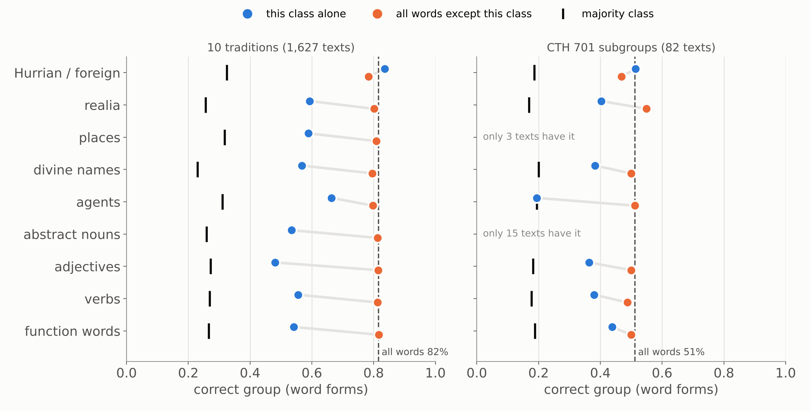{fig-align="center" width="85%"}

::: {.small}
The categories of StBoT 73 Table 4, with its realia split by meaning. Each class alone (blue) and everything except it (orange); word forms, leave one manuscript out.
:::

::: {.notes}
Removing any one class except foreign words costs at most two points (82% → 80–82%): no single class carries tradition alone.
Function words and verbs alone reach 54–56% against a majority baseline of 27%, so formulae differ between traditions, but less than agents (66%), realia (59%), places (59%) or foreign words (84%). Abstract nouns (53%) and adjectives (48%) carry the least. Removing foreign words costs the most (82% → 78%).
Realia here are things only (artifacts, buildings, ritual materials, plants); before the split, the wider class 'realia' (all nouns and adjectives) reached 70% alone.
Inside CTH 701 the Hurrian recitations carry the subgroups: removing them costs the most (51% → 47%), yet 47% is still twice the majority baseline (21%).
:::

---

## What a placement rests on: similarity is not the decision

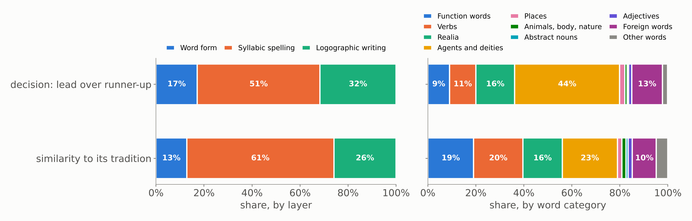{fig-align="center" width="100%"}

::: {.small}
The score is a cosine, so it splits exactly over the features, and each feature over the words it occurs in (word category) and its layer (word form, syllabic or logographic signs). Correctly placed reference manuscripts, leave one out.
:::

- **Similarity** to a tradition is 47% common material (*nu*, the signs *a*, *i*); **the decision** (lead over the runner-up) only 11%, because what all traditions share cancels
- **Delete the 100 most frequent words** (44% of all words): accuracy 84% → 83%

::: {.notes}
This answers the playground observation that "nu" carries weight: it carries similarity, which is what the playground shades, but not the decision. The 25 most frequent forms are 15% of the similarity and 2% of the decision.
What decides, by category: agents and deities 44%, realia 16%, foreign words 13%, verbs 11%, function words 9%; places 2%, adjectives 1%, abstract nouns 1%. Agents and deities include persons named by gloss (LUGAL 'king'), which the earlier scheme counted as realia. By layer: syllabic signs 51%, logographic signs 32%, word forms 17%.
Caveat: a syllabic sign n-gram carries the word as well as its spelling (ḫu-wa-aš is Ḫuwaššanna). The spelling layer of the layers slide isolates the spelling choice: it adds about one point.
Files: run_attribution.py, E11_report.json, E11a_category_by_layer.csv, E11b_top_features.csv.
:::

---

## Each tradition is decided by different words

::: {.small}

| Tradition | What carries its decisions | Share |
|---|---|---:|
| Ḫuwaššanna festivals | agents and deities | 79% |
| Palaic festivals | agents and deities; Palaic words | 60%; 32% |
| Kizzuwatna rituals | realia (SÍG "wool"); function words | 26%; 14% |
| Luwian festivals (Ištanuwa, Lallupiya) | agents and deities; places (Ištanuwa) | 35%; 28% |
| Hattian cult layer | agents and deities; Hattian words; verbs | 47%; 24%; 18% |
| Mixed (Hurrian, Syrian, Luwian) | agents and deities; function words (KI.MIN, EGIR-*anda-ma*) | 43%; 31% |
| Syro-Mesopotamia (Hurrian) | realia; function words; foreign words | 37%; 21%; 17% |
| Kizzuwatna–Lower Land (Hurrian) | realia (NINDA.GUR₄.RA "thick bread"); verbs | 28%; 17% |

:::

[Share of the margin over the runner-up, correctly placed manuscripts (E11). The two small ritual groups (4 and 7 correct manuscripts) are left out.]{.small}

---

## When the decision rests on common material, distrust it

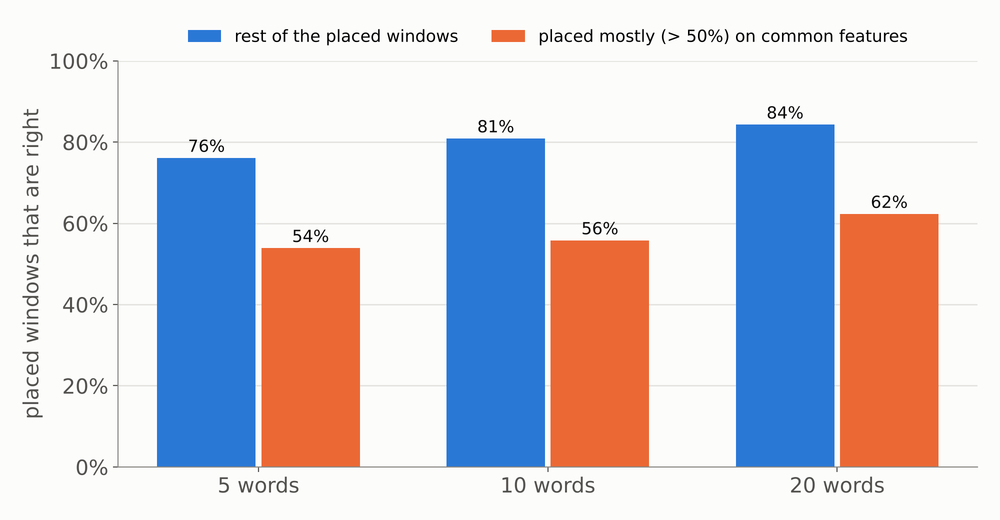{fig-align="center" width="80%"}

::: {.small}
Windows of 5, 10 and 20 words from held-out reference manuscripts, placed with the abstention margin. Common features: attested in at least a quarter of the reference manuscripts.
:::

::: {.notes}
Short windows placed mostly on common features are right 54–62% of the time, against 76–84% for the rest. For short fragments the worry about *nu* is right: in orphans of 5–10 words common features carry 28% of the decision.
227 of the 847 assigned orphans rest mostly on common features; they are flagged in E11a_orphan_decomposition.csv as weaker placements.
Refitting without function words, 651 of the 847 assigned orphans keep their tradition, 5 move and 191 fall below the margin (E11e).
:::

---

## CTH 701: recovering Salvini and Wegner's groups

::: {.columns}
::: {.column width="55%"}
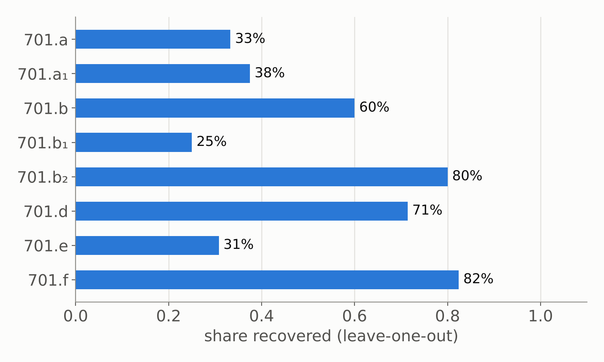{width="100%"}
:::
::: {.column width="45%"}
- 82 manuscripts in 8 groups (a–f), labels from the Mainz Konkordanz (one Konkordanz error corrected)
- 57% recovered, against a 21% majority baseline
- The unlabelled 701 fragments and group f are placed among a–e as candidate attributions (table in the repo)
:::
:::

# Back to the fragment

::: {.absolute top="0" left="96%"}
::: sectionhead
[1 2 3 4 5 6]{style="opacity:0.25"} 7 [8]{style="opacity:0.25"}
:::
:::

---

## KBo 41.22: which words decide

::: {.columns}
::: {.column width="52%"}


[Shading: each word's share of the decision.]{.small}
:::
::: {.column width="48%"}
- Nearest: **Luwian rituals of Puriyanni and Kuwattalla** (similarity 0.39), runner-up the Kizzuwatna rituals (0.25)
- Margin 0.144, **eight times** the abstention rule (0.018): a confident placement
- Carried by three words: *EME-an* "tongue", *pangawaš* "of the multitude", *karpin* "anger"; the first two have readings that disagree, so they count as other words, *karpin* as an abstract noun
- The function words and the common material **argue against** it (−14% and −21%): this is not a placement made on *nu*
:::
:::

::: {.notes}
From run_case.py (case_KBo_41_22.json): decision_features, decision_by_layer_category.
The Old Woman (ŠU.GI) is shared with the Kizzuwatna rituals and helps little.
:::

---

## KBo 41.22: the placement, step by step

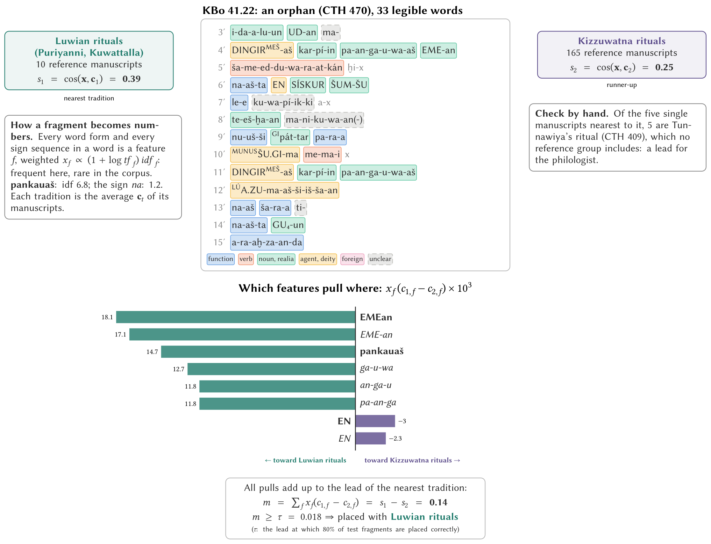{.r-stretch}

::: {.notes}
Same figure as the paper's worked example (run_case.py, case_KBo_41_22.json).
Every word and sign sequence is a feature; the pulls toward the nearest tradition add up exactly to the margin 0.14, eight times the abstention rule.
:::

---

## KBo 41.22: its nearest manuscripts

::: {.columns}
::: {.column width="52%"}
::: {.small}

| Manuscript | CTH | similarity |
|---|---|---:|
| KBo 9.125+ | 409 Tunnawiya | 0.349 |
| KBo 21.6 | 409 Tunnawiya | 0.341 |
| CHDS 7.140+ | 409 Tunnawiya | 0.327 |
| KBo 64.11 | 409 Tunnawiya | 0.297 |
| KBo 29.197+ | 409 Tunnawiya | 0.297 |
| KBo 43.220 | 760 Kuwattalla | 0.293 |
| KBo 7.55 | 760 Kuwattalla | 0.291 |
| KBo 53.222+ | 409 Tunnawiya | 0.290 |

:::
:::
::: {.column width="48%"}
- The closest manuscripts are not in the reference at all: they are **Tunnawiya's rituals (CTH 409)**, which no tradition includes
- Its words, counted across the whole corpus: *pangawaš* in 11 CTH 409 manuscripts and 4 of CTH 760; *EME-an* in 13 and 7
- **For the philologist:** look for the parallel in KBo 9.125+ and KBo 21.6 first
:::
:::

::: {.notes}
Nearest manuscripts among the reference and the unassigned CTH 390–469 rituals, in the same feature space (run_case.py, nearest_manuscripts, distinctive_words_by_cth).
:::

---

## Testing the hint: is Tunnawiya part of the Kuwattalla tradition?

::: {.columns}
::: {.column width="50%"}
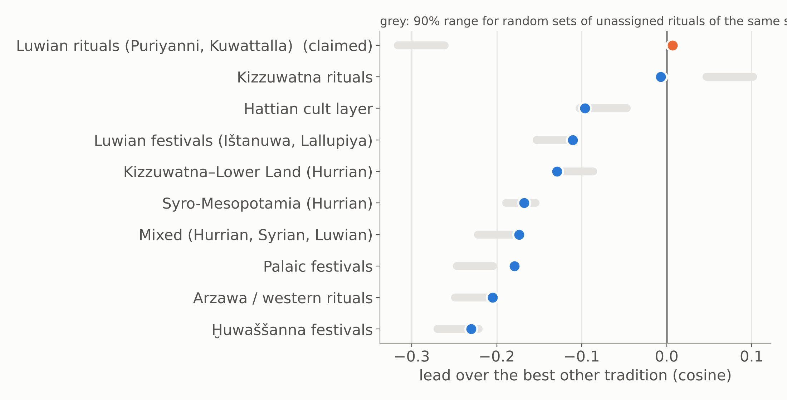{width="100%"}
:::
::: {.column width="50%"}
::: {.smallish}
- The 32 Tunnawiya manuscripts (CTH 409), pooled, are nearest to **Puriyanni and Kuwattalla**, just ahead of the Kizzuwatna rituals (+0.007)
- Random unassigned rituals fall far below Kuwattalla (−0.29); Tunnawiya does not: **p = 0.0005**
- Random rituals lean toward Kizzuwatna (+0.08); Tunnawiya does not: it is **less Kizzuwatna-like than a generic ritual**
- One by one, the manuscripts split 14 Kuwattalla, 14 Kizzuwatna
:::
:::
:::

::: {.notes}
Same test as for Ambazzi (run_hypotheses.py --cths 409, results/tlhdig03_literature/tunnawiya/).
This fits Laroche's comparison and Mouton's Lower Land setting, and Miller's separation of CTH 409 from the Kizzuwatna rituals. The per-manuscript split is a caution: short manuscripts of either tradition look alike.
A fragment led us to a statement about a whole composition.
:::

# Orphans placed

::: {.absolute top="0" left="96%"}
::: sectionhead
[1 2 3 4 5 6 7]{style="opacity:0.25"} 8
:::
:::

---

## Where do CTH 470 and EBo fragments go?

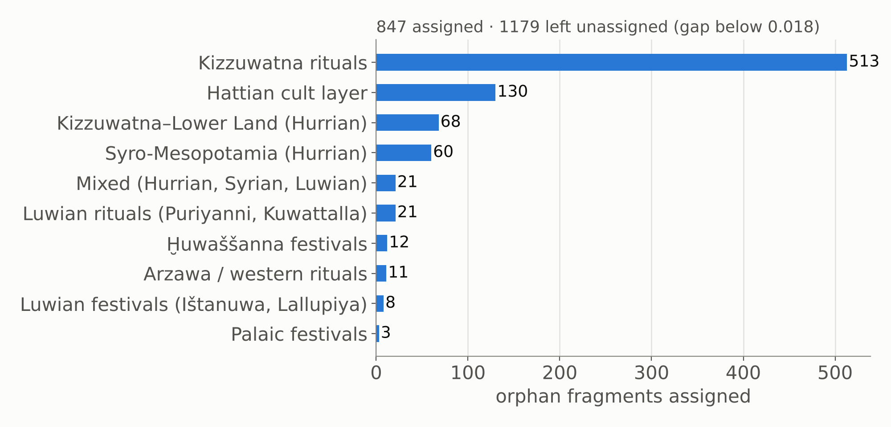{fig-align="center" width="80%"}

::: {.small}
Orphans with 5+ legible words. A fragment is assigned only when its lead over the runner-up passes the margin at which the window test reaches 80% precision (0.018; bootstrap 90% interval 0.018–0.019).
:::

::: {.notes}
847 of 2,026 orphans assigned: Kizzuwatna rituals 513, Hattian 130, Kizzuwatna–Lower Land 68, Syro-Mesopotamia 60, Puriyanni/Kuwattalla 21, Mixed 21, Ḫuwaššanna 12, Arzawa 11, Ištanuwa/Lallupiya 8, Palaic 3.
:::

---

## Testing Laroche's bins

::: {.columns}
::: {.column width="50%"}
**CTH 500**, "fragments of Kizzuwatna rituals"

- 132 of 242 manuscripts placed
- only **53** go to the Kizzuwatna rituals; **78** go to the Hurrian festival groups (32 Syro-Mesopotamia, 31 Kizzuwatna–Lower Land, 15 Mixed)
- Fits HFR, which counts CTH 500 among its festival texts
:::
::: {.column width="50%"}
**CTH 390–469**, rituals no study groups

- 169 of 314 manuscripts placed
- **138** to the Kizzuwatna rituals, 15 Hattian, 12 Puriyanni/Kuwattalla
- The largest ritual tradition attracts generic ritual language: a Kizzuwatna placement of a ritual fragment is the **weakest kind**
:::
:::

---

## Does a fragment fit any known tradition?

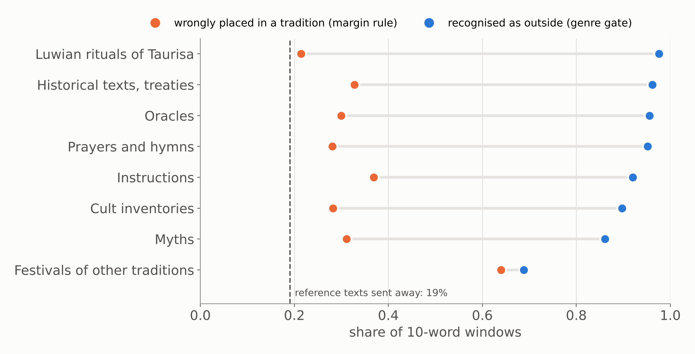{fig-align="center" width="80%"}

::: {.small}
Texts of genres outside the reference (Laroche's genre blocks; cult inventories, Cammarosano 2021; Luwian rituals of Taurisa, CTH 764–766), cut to 10-word windows. Orange: share placed in a tradition anyway. Blue: share recognised as outside when the outside genres become classes of their own.
:::

::: {.notes}
The margin rule alone still places 12–33% of windows of other genres, and 60% of festivals of other traditions.
A genre gate recognises 87–97% of the other genres and 62% of the other festivals, at the cost of sending 22% of reference windows away.
Applied to the orphans: 212 of 2,026 are closer to an outside genre than to any tradition, beyond the margin; 73 of them had been assigned (Hattian-layer orphans that look like festivals of other traditions, 21; Kizzuwatna orphans that look like myths, 16, or instructions, 10). These are candidates for re-filing.
:::

---

## QTM: orphans as witnesses of archetypes

- Each tradition is an **archetype**, approximated by its 200 most characteristic terms
- Each orphan is a **witness** that attests a small part of it
- **Coverage**: how much of each archetype the orphans placed in it attest together
- Kizzuwatna rituals 100% (513 orphans), Hattian 98% (130), Kizzuwatna–Lower Land 94% (68), Syro-Mesopotamia 92% (60); the small traditions 28–68% (3–21 orphans)

::: {.notes}
Coverage grows with the number of orphans, so these numbers need rarefaction (equal orphan counts per tradition) before they can be compared.
Archetypes with little coverage are transmissions we see only through the reference corpus.
:::

---

## What we learned about the traditions

::: {.smallish}
- **Coherent, composition by composition:** the Hattian cult layer (25 of 25 compositions), Ḫuwaššanna (5 of 5), the Kizzuwatna rituals (16 of 18)
- **StBoT 73's Luwian group is two traditions:** Ištanuwa and Lallupiya vs Ḫuwaššanna, as the HFR edition splits them
- **The three Hurrian festival groups are a continuum:** held together by their large compositions (7 of 17 recovered); CTH 500 belongs with them more than with the Kizzuwatna rituals
- **Palaic festivals lean to the Hattian layer** (3 of 5 compositions): a shared Old Anatolian cult layer
- **Traditions are marked by different things:** deities and cult personnel (Ḫuwaššanna, Palaic), ritual materials (Kizzuwatna), language layer (Hattian, Palaic), formulae (Mixed, Syro-Mesopotamia)
- **Spelling marks the copying line, not the tradition**
- **Two scholarly questions answered by the data:** the Ambazzi rituals are not western; Tunnawiya goes with Kuwattalla and away from Kizzuwatna
:::

---

## What the method adds, and its limits

::: {.columns}
::: {.column width="50%"}
**Adds**

- A placement **or an honest abstention** for each fragment, with its strength
- The **words behind** each placement, to check by eye
- **Nearest manuscripts** as candidate parallels and joins
- Tests of scholarly groupings against random rituals
:::
::: {.column width="50%"}
**Limits**

- Short fragments: 10 words are right 65% of the time
- Placements resting on **common material** are weak (227 of 847)
- Small traditions (Arzawa, Puriyanni/Kuwattalla: 10–11 manuscripts) cannot yet be trusted
- Word categories are rule-based and **12% low-confidence**; the noun meanings come from a gloss list that has not been audited
- Festival manuscripts differ by use (Burgin 2019), which word profiles may pick up
:::
:::

::: {.notes}
Next steps: rarefied coverage; an audit of the noun meaning classes; sign-shape measurement (DANES 2025) for the same fragments; worked examples per tradition for colleagues to verify.
:::

---

## Thank you

Code and data: [github.com/shaigordin/measuring-scribal-literacy](https://github.com/shaigordin/measuring-scribal-literacy) (`orphans/`)

TLHdig 0.3: [doi.org/10.5281/zenodo.20328284](https://doi.org/10.5281/zenodo.20328284)
