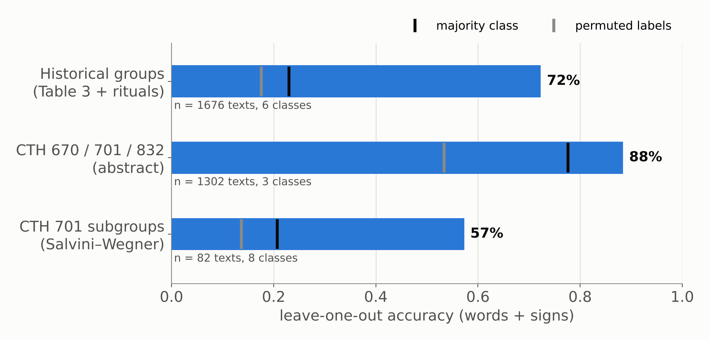

# The orphan problem

::: {.absolute top="0" left="96%"}
::: sectionhead
1 [2 3 4 5 6]{style="opacity:0.25"}
:::
:::

---

## Orphans: fragments without a tradition

::: {.columns}
::: {.column width="55%"}
- Laroche's residual category **CTH 470**: ritual fragments that could not be placed
- The **EBo** fragments, now digitised in TLHdig 0.3 (May 2026)
- Traditional assignment needs a **parallel passage**, which is exactly what these texts lack
- So: can the *content and spelling* of a fragment point to its tradition?
:::

::: {.column width="45%"}
::: {.small}

| TLHdig 0.3 | texts | median legible words |
|---|---:|---:|
| CTH 470 | 1,919 | 10 |
| EBo (all CTHs) | 1,151 | 4 |
| of which filed under CTH 832 | 562 | |
| of which filed under CTH 670 | 382 | |

:::

[EBo fragments are filed mostly under CTH 832 and 670, which are themselves residual categories.]{.small}
:::
:::

::: {.notes}
Point out that "orphan" in TLHdig is a spread condition: 470, 670 and 832 all collect them.
The EBo median of 4 words is the hard constraint for everything that follows.
:::

---

## Where we left off: StBoT 73

::: {.columns}
::: {.column width="50%"}
- Gordin, Yavasan and Romach 2025: tf-idf + t-SNE over ~1,000 Hurrian and Luwian festival texts
- Three "constellations"; Luwian cult centres coherent, the Hurrian groups split
- CTH 701 under the microscope: KBo 23.44 (a.B, Nananza under Anuwanza) vs KBo 38.281+ (a₁.3, MS)
- **Next step announced there:** test which word groups carry the signal
:::
::: {.column width="50%"}
<!-- Fig. 1 galaxy from StBoT 73 (Drive: Mainz paper/Figures) -->
:::
:::

---

# From exploration to assignment

::: {.absolute top="0" left="96%"}
::: sectionhead
[1]{style="opacity:0.25"} 2 [3 4 5 6]{style="opacity:0.25"}
:::
:::

---

## Method: a reference space of traditions

::: {.columns}
::: {.column width="50%"}
1. **Corpus:** TLHdig 0.3 XML, 23,526 manuscripts, 1.24 M words, converted following Yavasan and Gordin, *From Clay to Code* (ALP 2025)
2. **Two feature spaces**
   - word tf-idf (normalised forms) for content
   - sign n-grams (1–3 signs within a word) for orthography
3. **Traditions as centroids:** each tradition is the mean of its manuscripts
4. **Assignment:** a fragment goes to its most similar centroid, *or to none* if the lead over the runner-up is too small (open set)
:::
::: {.column width="50%"}
**Reference traditions**, each defined by the study that argued for it

::: {.small}
- Hurrian festivals (StBoT 73): Kizzuwatna–Lower Land; Syro-Mesopotamia, incl. CTH 701; Mixed
- Luwian and Palaic festivals (HFR modules): Ištanuwa and Lallupiya; Ḫuwaššanna; Palaic
- Kizzuwatna rituals (Miller 2004): CTH 471–499 + 404
- Western (Arzawa) rituals (colophons; Bawanypeck 2005)
- Luwian rituals of Puriyanni and Kuwattalla (StBoT 72)
- Hattian cult layer (Klinger 1996)
:::

[Orphans (CTH 470 + EBo) are never part of the reference.]{.small}
:::
:::

---

## Why these ten traditions

::: {.small}

| Tradition | CTH | Defined by | Evidence | Texts |
|---|---|---|---|---|
| Kizzuwatna–Lower Land (Hurrian) | 628, 699, 700, 711–713, 719, 722 | StBoT 73; ChS I/4 | cult geography | 311 |
| Syro-Mesopotamia (Hurrian) | 698, 701, 714, 715, 721 | StBoT 73; ChS I/2 | cult geography; AZU priest | 164 |
| Mixed (Hurrian, Syrian, Luwian) | 704–706, 720 | StBoT 73 | mixed pantheon | 198 |
| Luwian festivals (Ištanuwa, Lallupiya) | 665, 771–773 | HFR module | CTH list published by HFR | 50 |
| Ḫuwaššanna festivals | 690–694 | HFR module; Laroche | the goddess in every title | 180 |
| Palaic festivals | 750–754 | HFR module | Palaic; CTH list published by HFR | 34 |
| Kizzuwatna rituals | 471–499, 404 | Miller 2004; Strauß 2006 | practitioners "from Kizzuwatna" | 164 |
| Western (Arzawa) rituals | 394, 402, 406, 410, 425, 433 | colophons; Bawanypeck 2005; Archi 2015 | "from Arzawa / Ḫapalla"; augurs | 11 |
| Luwian rituals (Puriyanni, Kuwattalla) | 758–763 | Yakubovich and Mouton 2023 | named practitioners; Lower Land | 10 |
| Hattian cult layer | 591, 627, 725–746, 820, 821 | Klinger 1996 | Hattian deities and language | 478 |

:::

[Placed like orphans instead: CTH 500 (a running list of fragments), the Ambazzi rituals 391, 429, 463 (Luwian influence but no stated link to Arzawa; Christiansen 2006), and the rest of CTH 390–469. Texts = manuscripts of 17+ words.]{.small}

---

# Does it work?

::: {.absolute top="0" left="96%"}
::: sectionhead
[1 2]{style="opacity:0.25"} 3 [4 5 6]{style="opacity:0.25"}
:::
:::

---

## Validation: the StBoT 73 groups

{fig-align="center" width="80%"}

::: {.small}
Every manuscript of 17+ words is removed in turn and reassigned. Baselines: always guessing the largest class, and the same procedure with shuffled labels (200 permutations).
:::

::: {.notes}
Historical groups: 72% over 6 classes, against a 23% majority baseline.
CTH 670/701/832 as in the abstract: 89%, but the majority baseline is already 78% (CTH 670 dominates), so it shows little.
This is why the reference space moved to historical groups, and then to traditions defined in the literature (next slide).
:::

---

## Validation with literature-defined traditions

{fig-align="center" width="80%"}

::: {.small}
Kizzuwatna rituals = CTH 471–499 + 404 (Miller 2004); Western (Arzawa) = CTH 394, 402, 406, 410 (colophon: from Arzawa or Ḫapalla) and 425, 433 (augurs; Bawanypeck 2005); Luwian rituals of Puriyanni and Kuwattalla = CTH 758–763 (Yakubovich and Mouton 2023); Hattian cult layer = Klinger 1996 (from the Konkordanz citations of StBoT 37); the three Hurrian festival groups of StBoT 73; StBoT 73's Luwian group split as the HFR edition modules split it (Ištanuwa and Lallupiya: CTH 665, 771–773; Ḫuwaššanna: 690–694), plus HFR's Palaic festivals (750–754). CTH 390–469 texts claimed by no study (including the Ambazzi rituals) and the CTH 500 fragment collection leave the reference and are placed like orphans.
:::

::: {.notes}
84% over 10 traditions against 30% majority, up from 72% with the CTH-range controls.
Hattian 95%, Kizzuwatna 92%, Ḫuwaššanna 91%, Ištanuwa/Lallupiya 84%, Palaic 82%. The two small ritual groups are weakest: Arzawa 64% (11 manuscripts long enough to test), Puriyanni/Kuwattalla 40% (10).
The HFR split holds: StBoT 73's single Luwian group hides two cult traditions that the texts keep apart.
CTH 500 ("fragments of Kizzuwatna rituals", 235 manuscripts) is a fragment collection, not a composition, and it pulled every generic ritual into Kizzuwatna. Placed like orphans, only 54 of its 128 assigned fragments go to the Kizzuwatna rituals; 73 go to the Hurrian festival groups. That fits HFR, which counts CTH 500 among its festival texts.
The CTH 390–469 residue still goes mostly to Kizzuwatna (152 of 186 assigned), 13 to Puriyanni/Kuwattalla: the only large ritual class wins on genre, not on origin. The Ambazzi manuscripts go 3 to Kizzuwatna, 3 unassigned, none to Arzawa.
:::

---

## How small can an orphan be?

{fig-align="center" width="75%"}

::: {.small}
Long manuscripts are cut into random windows of *k* words and reassigned. Words and signs perform alike, and signs are slightly better from about 8 words up.
:::

::: {.notes}
3 words: about 53%; 10 words: about 68%; 40 words: about 79%, against a chance level of 10% (10 traditions).
This curve sets the abstention rule used for the orphans.
:::

---

## Is it vocabulary, orthography, or date?

::: {.columns}
::: {.column width="50%"}
**Remove all logograms** (Sumero- and Akkadograms)

- word tf-idf: 81% → 75%
- sign n-grams: 84% → 81%

The signal survives without the cultic logographic vocabulary.
:::
::: {.column width="50%"}
**Script date in CTH 701** (MS vs NS)

- the same method *cannot* predict MS vs NS above the majority baseline

So the 701 groupings are not just script-date clusters.
:::
:::

---

# Scribal or cultural?

::: {.absolute top="0" left="96%"}
::: sectionhead
[1 2 3]{style="opacity:0.25"} 4 [5 6]{style="opacity:0.25"}
:::
:::

---

## What identifies a tradition: what is written, or how?

{fig-align="center" width="78%"}

::: {.small}
Each layer alone, leave one manuscript out, 10 traditions, 1,601 manuscripts. *Only the 396 manuscripts with foreign-language words. Orthographic habits: 10-fold LDA on seven per-text rates.
:::

::: {.notes}
Content carries the identity: logograms 70%, Hittite vocabulary 71%, foreign-language words 88% where present.
Keeping the spelling of variable words adds next to nothing (61% vs 60% with spelling ignored): spelling choice does not mark a tradition beyond the words themselves.
Text-level orthographic habits are a weak but real signal: 39% against 30% for shuffled labels (p = 0.01).
:::

---

## Cultural profiles: each tradition's distinctive vocabulary

::: {.small}

| Tradition | Logograms | Hittite and foreign words |
|---|---|---|
| Kizzuwatna rituals | SÍG, ZA.GÌN, SA₅, LÀL, ŠU.GI | *tarpalli-*, *ḫuittiya-*, *kureššar*, *lukkatta* |
| Kizzuwatna–Lower Land | *UP-NI*, BA.BA.ZA, *NAM-MA-AN-DUM* | *manuzzi*, *nupatik*, *šipant-*, *keldi* |
| Syro-Mesopotamia | AZU, EREN, SÍSKUR, AD.KID | *ḫurlili*, *ḫuprušḫi*, *aḫrušḫi*, *kelu* |
| Mixed | KI.MIN, NINDA.SIG, IŠTAR | Ḫepat, Ninatta, Kulitta |
| Ištanuwa and Lallupiya | ZA.LAM.GAR, KA.GAG, DUMU.LUGAL | *ḫuḫupal*, *kimri*, *ḫuwaši* |
| Ḫuwaššanna | *BE-EL*, NAR, SÌR-RU, KAŠ | *palwai-*, *aku-* "drink", *takarmun* |
| Palaic festivals | GEŠTIN, ŠU.GI, *AŠ-RI* | *išnuri*, *ziparwa*, *kataḫzipuri*, *ḫašammili* |
| Hattian cult layer | LUGAL, DUMU.É.GAL, GIŠ.INANNA, ALAM.ZU₉, MUḪALDIM | *ḫalzai*, *petai*, *taparna*, *katte* |
| Western (Arzawa), 11 texts | KAL, MUŠEN.DÙ, TU₇ | *kurša-*, *pattar*, *lak-* |
| Puriyanni and Kuwattalla, 10 texts | EME, SAG.DU, ŠU.GI | *pankawaš*, *karpi-*, *linkiya-* |

:::

[Weighted log-odds with an informative prior (Monroe et al. 2008), counted by manuscripts. Full lists in `E7_distinctive_features.csv`.]{.small}

::: {.notes}
These are ritual materials, offerings, performers and deities: the cultural and religious "artefacts" of each tradition.
:::

---

## Scribal profiles: habits of copying lines, not regions

::: {.columns}
::: {.column width="58%"}
{width="100%"}
:::
::: {.column width="42%"}
::: {.small}

| Same word, plene spelling | where it clusters |
|---|---|
| *me-ma-a-i* (vs *me-ma-i*) | 18 of 46 Kizzuwatna–Lower Land texts, all CTH 628 and 712 |
| *pé-e-ra-an* (vs *pé-ra-an*) | 5 of 19 Ištanuwa/Lallupiya texts, all CTH 665 |
| *me-ma-a-i* | 10 of 79 Hattian-layer texts, CTH 591, 627, 733, 820 |

:::

- Spelling habits attach to **compositions and their copies**, not to whole traditions
- Palaic festivals: fewest logograms, most phonetic complements
- Script date (MS vs NS) is **not** predicted by these rates inside CTH 701
:::
:::

::: {.notes}
This is the QTM point: orthography marks the witness and its copying line; vocabulary marks the archetype.
The Hattian layer leans to plene writing and few logograms, which may be date (Old Hittite manuscripts) as much as tradition; to check against script labels.
:::

---

## Word classes: function words and verbs are not where tradition lives

{fig-align="center" width="85%"}

::: {.small}
The six categories of StBoT 73 Table 4, assigned from TLHdig's morphological analyses. Each class alone (blue) and everything except it (orange); word forms, leave one manuscript out.
:::

::: {.notes}
Removing function words, verbs or agents costs almost nothing for the ten traditions (81% → 80–81%): these classes are shared across traditions, a common scribal and syntactic layer.
Alone they still reach 53–57% against 30%, so formulae differ between traditions, but less than realia (71%) or foreign words (87%). Removing foreign words costs the most (81% → 78%).
Inside CTH 701 the Hurrian recitations carry the subgroups: removing them costs the most (50% → 47%), yet 47% is still twice the majority baseline (21%), so the Hittite frame text also differs between the subgroups.
:::

---

# CTH 701 as a test bed

::: {.absolute top="0" left="96%"}
::: sectionhead
[1 2 3 4]{style="opacity:0.25"} 5 [6]{style="opacity:0.25"}
:::
:::

---

## Recovering Salvini and Wegner's groups

::: {.columns}
::: {.column width="55%"}
{width="100%"}
:::
::: {.column width="45%"}
- 82 manuscripts in 8 groups (a–f), labels from the Mainz Konkordanz (one Konkordanz error corrected)
- ~58% recovered, against a 21% majority baseline
- The unlabelled 701 fragments and group f are placed among a–e as candidate attributions (table in the repo)
:::
:::

---

# Orphans placed

::: {.absolute top="0" left="96%"}
::: sectionhead
[1 2 3 4 5]{style="opacity:0.25"} 6
:::
:::

---

## Where do CTH 470 and EBo fragments go?

{fig-align="center" width="80%"}

::: {.small}
Orphans with 5+ legible words. A fragment is assigned only when its lead over the runner-up passes the margin at which the coverage experiment reaches 80% precision (0.016; bootstrap 90% interval 0.015–0.017, i.e. 889–981 orphans assigned).
:::

---

## Does a fragment fit any known tradition?

{fig-align="center" width="80%"}

::: {.small}
Texts of genres outside the reference (Laroche's genre blocks; cult inventories, Cammarosano 2021; Luwian rituals of Taurisa, CTH 764–766, Mouton and Yakubovich 2021), cut to 10-word windows, 5 folds. Orange: share placed in a tradition anyway. Blue: share recognised as outside when the outside genres become classes of their own.
:::

::: {.notes}
The margin rule only asks "which tradition, if any": it still places 28–37% of myth, prayer, oracle, treaty, instruction and inventory windows, and 64% of festivals of other traditions.
A "fit" floor (similarity below what 95% of reference windows reach) separates other genres fairly well (AUROC 0.77–0.92) but not other festivals (0.56).
A genre gate works better: it recognises 86–98% of the other genres and 69% of the other festivals, at the cost of sending 19% of reference windows away.
Applied to the orphans: 255 of 2,010 are closer to an outside genre than to any tradition, beyond the margin; 96 of them had been assigned, mostly Hattian-layer orphans that look like festivals of other traditions (29) and Kizzuwatna orphans that look like instructions (18) or myths (14). These are candidates for re-filing.
:::

---

## QTM: orphans as low-coverage witnesses

- Each tradition is treated as an **archetype**, approximated by its most characteristic terms
- Each orphan is a **witness** that attests a small part of it
- **Coverage** asks how much of each archetype the orphans collectively attest
- Archetypes with little coverage are transmissions we only see through the reference corpus. High coverage from orphans alone points to traditions that circulated widely in fragments.

::: {.notes}
E6, first pass: the Kizzuwatna rituals (574 assigned orphans) and the Hattian layer (142) attest 100% and 98% of their 200 core terms, the Hurrian festival groups 66–93%, and the small groups (Luwian, Palaic, Arzawa, Puriyanni/Kuwattalla; 4–22 orphans each) 34–67%.
Coverage grows with the number of orphans, so these numbers still need rarefaction (equal orphan counts per tradition) before they can be compared.
:::

---

## Limits and next steps

- **Normalisation:** TLHdig `trans` forms are uneven across editors, and broken words are dropped
- **Preservation bias:** short fragments over-represent formulaic lines
- **Open set:** the genre gate needs more outside classes, and the two small ritual traditions (Arzawa, Puriyanni/Kuwattalla) need more manuscripts before they can be trusted
- **Function, not tradition:** festival manuscripts differ by use (Burgin 2019, StBoT 65), which word profiles may pick up
- **Joins:** an orphan placed near a known manuscript is a candidate join to check on the tablet
- **Palaeography:** link to sign-shape measurement (DANES 2025) for the same fragments
- **Philological check:** worked examples (top-ranked orphans per tradition) for colleagues to verify

---

## Thank you

Code and data: [github.com/shaigordin/measuring-scribal-literacy](https://github.com/shaigordin/measuring-scribal-literacy) (`orphans/`)

TLHdig 0.3: [doi.org/10.5281/zenodo.20328284](https://doi.org/10.5281/zenodo.20328284)
