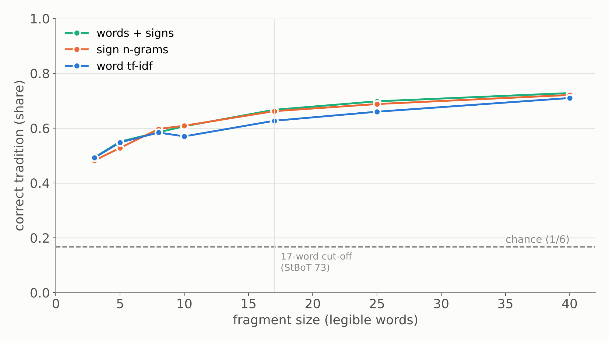
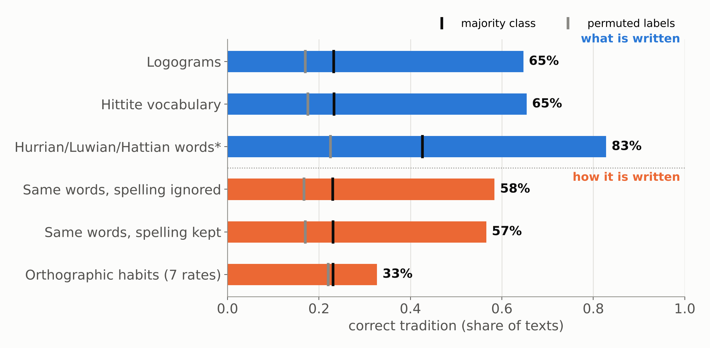
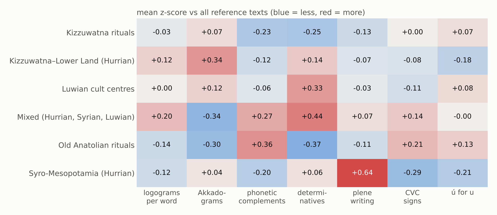
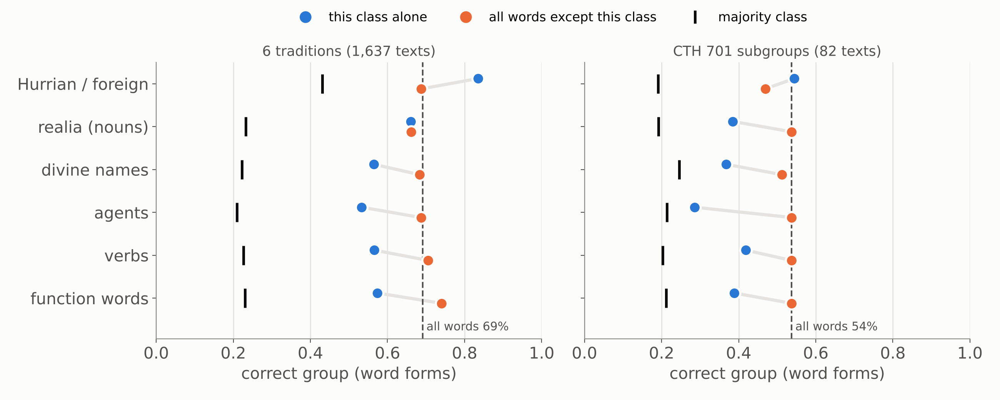
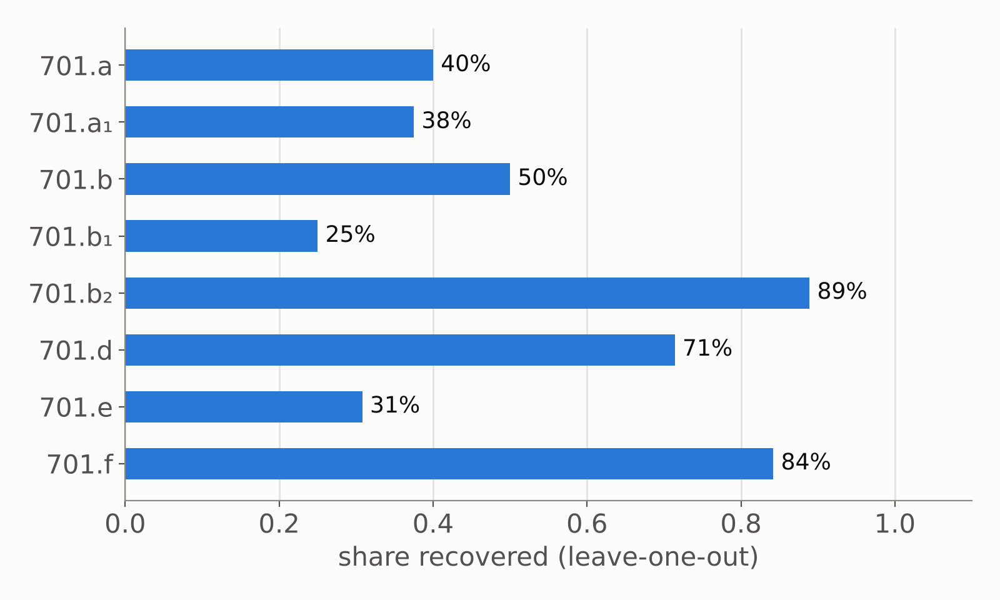
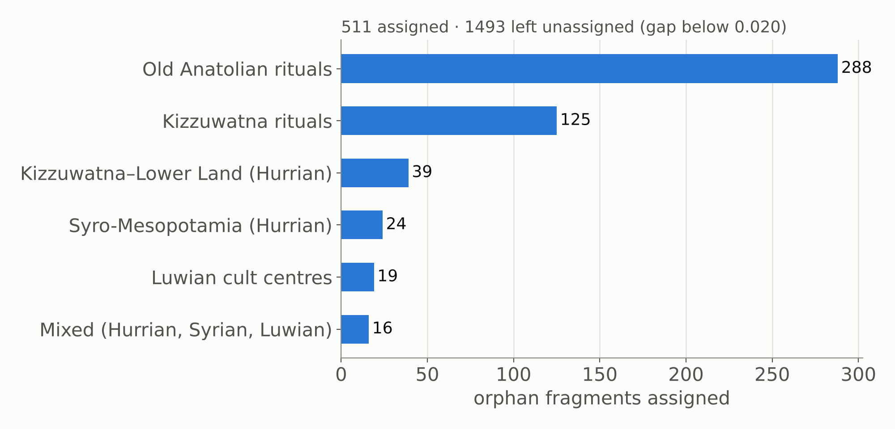

# The orphan problem

::: {.absolute top="0" left="96%"}
::: sectionhead
1 [2 3 4 5 6]{style="opacity:0.25"}
:::
:::

---

## Orphans: fragments without a tradition

::: {.columns}
::: {.column width="55%"}
- Laroche's residual category **CTH 470**: ritual fragments that could not be placed
- The **EBo** fragments, now digitised in TLHdig 0.3 (May 2026)
- Traditional assignment needs a **parallel passage**, which is exactly what these texts lack
- So: can the *content and spelling* of a fragment point to its tradition?
:::

::: {.column width="45%"}
::: {.small}

| TLHdig 0.3 | texts | median legible words |
|---|---:|---:|
| CTH 470 | 1,919 | 10 |
| EBo (all CTHs) | 1,151 | 4 |
| of which filed under CTH 832 | 562 | |
| of which filed under CTH 670 | 382 | |

:::

[EBo fragments are filed mostly under CTH 832 and 670, which are themselves residual categories.]{.small}
:::
:::

::: {.notes}
Point out that "orphan" in TLHdig is a spread condition: 470, 670 and 832 all collect them.
The EBo median of 4 words is the hard constraint for everything that follows.
:::

---

## Where we left off: StBoT 73

::: {.columns}
::: {.column width="50%"}
- Gordin, Yavasan and Romach 2025: tf-idf + t-SNE over ~1,000 Hurrian and Luwian festival texts
- Three "constellations"; Luwian cult centres coherent, the Hurrian groups split
- CTH 701 under the microscope: KBo 23.44 (a.B, Nananza under Anuwanza) vs KBo 38.281+ (a₁.3, MS)
- **Next step announced there:** test which word groups carry the signal
:::
::: {.column width="50%"}
<!-- Fig. 1 galaxy from StBoT 73 (Drive: Mainz paper/Figures) -->
:::
:::

---

# From exploration to assignment

::: {.absolute top="0" left="96%"}
::: sectionhead
[1]{style="opacity:0.25"} 2 [3 4 5 6]{style="opacity:0.25"}
:::
:::

---

## Method: a reference space of traditions

::: {.columns}
::: {.column width="50%"}
1. **Corpus:** TLHdig 0.3 XML, 23,526 manuscripts, 1.24 M words, converted following Yavasan and Gordin, *From Clay to Code* (ALP 2025)
2. **Two feature spaces**
   - word tf-idf (normalised forms) for content
   - sign n-grams (1–3 signs within a word) for orthography
3. **Traditions as centroids:** each tradition is the mean of its manuscripts
4. **Assignment:** a fragment goes to its most similar centroid, *or to none* if the lead over the runner-up is too small (open set)
:::
::: {.column width="50%"}
**Reference traditions** (StBoT 73, Table 3, plus ritual controls)

::: {.small}
- Kizzuwatna–Lower Land (Hurrian)
- Syro-Mesopotamia (Hurrian), incl. CTH 701
- Luwian cult centres
- Mixed (Hurrian, Syrian, Luwian)
- Kizzuwatna rituals (CTH 471–500)
- Old Anatolian rituals (CTH 390–469)
:::

[Orphans (CTH 470 + EBo) are never part of the reference.]{.small}
:::
:::

---

# Does it work?

::: {.absolute top="0" left="96%"}
::: sectionhead
[1 2]{style="opacity:0.25"} 3 [4 5 6]{style="opacity:0.25"}
:::
:::

---

## Validation: leave one manuscript out

{fig-align="center" width="80%"}

::: {.small}
Every manuscript of 17+ words is removed in turn and reassigned. Baselines: always guessing the largest class, and the same procedure with shuffled labels (200 permutations).
:::

::: {.notes}
Historical groups: 72% over 6 classes, against a 23% majority baseline.
CTH 670/701/832 as in the abstract: 89%, but the majority baseline is already 78% (CTH 670 dominates), so it shows little.
This is why the reference space moved to historical groups.
:::

---

## How small can an orphan be?

{fig-align="center" width="75%"}

::: {.small}
Long manuscripts are cut into random windows of *k* words and reassigned. Words and signs perform alike, and signs are slightly better from about 8 words up.
:::

::: {.notes}
3 words: about 49%; 10 words: about 61%; 40 words: about 73%, against a chance level of 17%.
This curve sets the abstention rule used for the orphans.
:::

---

## Is it vocabulary, orthography, or date?

::: {.columns}
::: {.column width="50%"}
**Remove all logograms** (Sumero- and Akkadograms)

- word tf-idf: 69% → 66%
- sign n-grams: 72% → 70%

The signal survives without the cultic logographic vocabulary.
:::
::: {.column width="50%"}
**Script date in CTH 701** (MS vs NS)

- the same method *cannot* predict MS vs NS above the majority baseline

So the 701 groupings are not just script-date clusters.
:::
:::

---

# Scribal or cultural?

::: {.absolute top="0" left="96%"}
::: sectionhead
[1 2 3]{style="opacity:0.25"} 4 [5 6]{style="opacity:0.25"}
:::
:::

---

## What identifies a tradition: what is written, or how?

{fig-align="center" width="78%"}

::: {.small}
Each layer alone, leave one manuscript out, 6 traditions, 1,637 manuscripts. *Only the 209 manuscripts with foreign-language words. Orthographic habits: 10-fold LDA on seven per-text rates.
:::

::: {.notes}
Content carries the identity: logograms and Hittite vocabulary 65% each, foreign-language words 83% where present.
Keeping the spelling of variable words adds nothing (57% vs 58% with spelling ignored): spelling choice does not mark a tradition beyond the words themselves.
Text-level orthographic habits are a weak but real signal: 33% against 22% for shuffled labels (p = 0.01).
:::

---

## Cultural profiles: each tradition's distinctive vocabulary

::: {.small}

| Tradition | Logograms | Hittite and foreign words |
|---|---|---|
| Kizzuwatna rituals | SISKUR, Ì.DU₁₀.GA, MUŠEN, SILA₄, ZA.GÌN | *tarpalli-*, *kureššar*, *ḫuittiya-*, *warnu-* |
| Kizzuwatna–Lower Land | NINDA.GUR₄.RA, BA.BA.ZA, *UP-NI* | *manuzzi*, Išḫara, *šipant-* |
| Luwian cult centres | SÌR-RU, NAR, *BE-EL* | *aku-* "drink", *palwai-* |
| Mixed | KI.MIN, NINDA.SIG, Ḫepat | Ninatta, Kulitta |
| Old Anatolian rituals | UTU, ŠU.GI, ALAM | *takna-*, *eštu* |
| Syro-Mesopotamia | AZU, EREN, AD.KID, BANŠUR | *aḫrušḫi*, *ḫuprušḫi*, *ḫurlili* |

:::

[Weighted log-odds with an informative prior (Monroe et al. 2008), counted by manuscripts. Full lists in `E7_distinctive_features.csv`.]{.small}

::: {.notes}
These are ritual materials, offerings, performers and deities: the cultural and religious "artefacts" of each tradition.
:::

---

## Scribal profiles: habits of copying lines, not regions

::: {.columns}
::: {.column width="58%"}
{width="100%"}
:::
::: {.column width="42%"}
::: {.small}

| Same word, plene spelling | where it clusters |
|---|---|
| *me-ma-a-i* (vs *me-ma-i*) | 18 of 46 Kizzuwatna–Lower Land texts, all CTH 628 and 712 |
| *pé-e-ra-an* (vs *pé-ra-an*) | 5 Luwian texts, all CTH 665 |
| *ḫal-za-i* (vs *ḫal-za-a-i*) | 9 of 27 Old Anatolian ritual texts |

:::

- Spelling habits attach to **compositions and their copies**, not to whole traditions
- The AZU corpus (CTH 701) stands out for plene writing
- Script date (MS vs NS) is **not** predicted by these rates inside CTH 701
:::
:::

::: {.notes}
This is the QTM point: orthography marks the witness and its copying line; vocabulary marks the archetype.
The ḫalzai contrast may be date (Old Hittite) rather than tradition; to check against script labels.
:::

---

## Word classes: function words and verbs are not where tradition lives

{fig-align="center" width="85%"}

::: {.small}
The six categories of StBoT 73 Table 4, assigned from TLHdig's morphological analyses. Each class alone (blue) and everything except it (orange); word forms, leave one manuscript out.
:::

::: {.notes}
Removing function words *raises* accuracy for the six traditions (69% → 74%): they are shared across traditions, a common scribal and syntactic layer.
Alone they still reach 57% against 23%, so formulae differ between traditions, but less than realia (66%) or Hurrian words (83%).
Inside CTH 701 the Hurrian recitations carry the subgroups: removing them costs the most (54% → 47%), yet 47% is still twice the majority baseline, so the Hittite frame text also differs between the subgroups.
:::

---

# CTH 701 as a test bed

::: {.absolute top="0" left="96%"}
::: sectionhead
[1 2 3 4]{style="opacity:0.25"} 5 [6]{style="opacity:0.25"}
:::
:::

---

## Recovering Salvini and Wegner's groups

::: {.columns}
::: {.column width="55%"}
{width="100%"}
:::
::: {.column width="45%"}
- 82 manuscripts in 8 labelled groups (a–f)
- ~60% recovered, against a 23% majority baseline
- The unlabelled 701 fragments and group f are placed among a–e as candidate attributions (table in the repo)
:::
:::

---

# Orphans placed

::: {.absolute top="0" left="96%"}
::: sectionhead
[1 2 3 4 5]{style="opacity:0.25"} 6
:::
:::

---

## Where do CTH 470 and EBo fragments go?

{fig-align="center" width="80%"}

::: {.small}
Orphans with 5+ legible words. A fragment is assigned only when its lead over the runner-up passes the margin at which the coverage experiment reaches 80% precision (0.020; bootstrap 90% interval 0.019–0.021, i.e. 461–548 orphans assigned).
:::

---

## QTM: orphans as low-coverage witnesses

- Each tradition is treated as an **archetype**, approximated by its most characteristic terms
- Each orphan is a **witness** that attests a small part of it
- **Coverage** asks how much of each archetype the orphans collectively attest
- Archetypes with little coverage are transmissions we only see through the reference corpus. High coverage from orphans alone points to traditions that circulated widely in fragments.

::: {.notes}
E6, first pass: the two ritual traditions (125 and 288 assigned orphans) attest all 200 of their core terms, the Hurrian festival groups 0.64–0.85, and "Mixed" (16 orphans) 0.58.
Coverage grows with the number of orphans, so these numbers still need rarefaction (equal orphan counts per tradition) before they can be compared.
:::

---

## Limits and next steps

- **Normalisation:** TLHdig `trans` forms are uneven across editors, and broken words are dropped
- **Preservation bias:** short fragments over-represent formulaic lines
- **Joins:** an orphan placed near a known manuscript is a candidate join to check on the tablet
- **Palaeography:** link to sign-shape measurement (DANES 2025) for the same fragments
- **Philological check:** worked examples (top-ranked orphans per tradition) for colleagues to verify

---

## Thank you

Code and data: [github.com/shaigordin/measuring-scribal-literacy](https://github.com/shaigordin/measuring-scribal-literacy) (`orphans/`)

TLHdig 0.3: [doi.org/10.5281/zenodo.20328284](https://doi.org/10.5281/zenodo.20328284)
